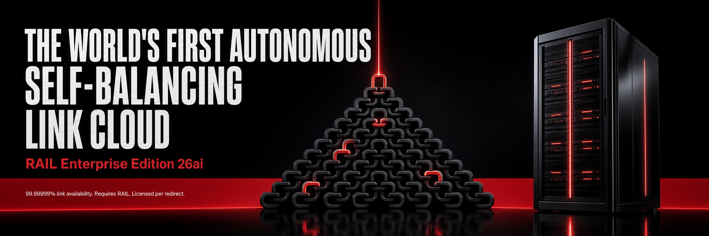
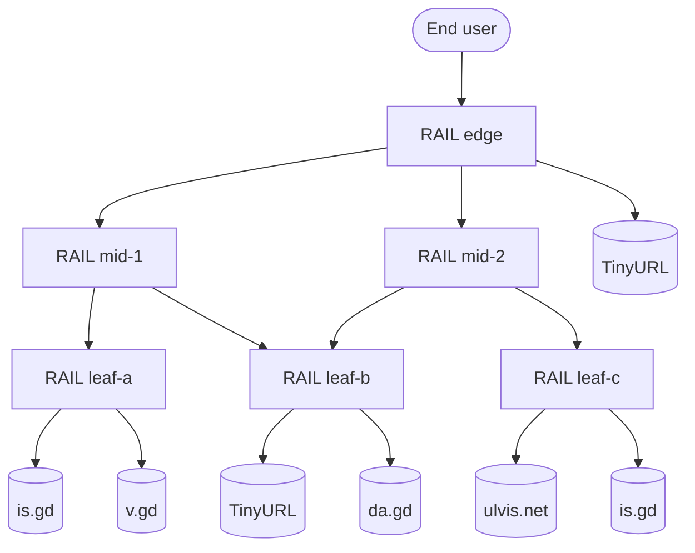

<p align="center">
  
</p>

<p align="center">
  <a href="https://github.com/HelgeSverre/rail-rs/actions/workflows/ci.yml"></a>
  <a href="https://github.com/HelgeSverre/rail-rs/releases/latest"></a>
  <a href="LICENSE"></a>
  <a href="https://github.com/HelgeSverre/rail-rs/pkgs/container/rail-rs"></a>
  <a href="charts/rail"></a>
  
  <br>
  
  
  
  
  
  
</p>

# RAIL: Redundant Array of Inexpensive Links

**RAIL is an enterprise-grade link resilience platform.** It protects your organization's
shortened URLs against provider failure by shortening every URL with multiple independent
third-party URL shortening vendors at once, then distributing inbound traffic across them with
continuous health verification.

RAIL is itself a URL shortener. A RAIL deployment can therefore serve as an upstream vendor for
another RAIL deployment. We call this **Recursive Redundancy™**.

> [!NOTE]
> RAIL is production-ready, in the sense that it runs in production.

---

## Table of contents

- [Executive summary](#executive-summary)
- [The problem](#the-problem)
- [The solution](#the-solution)
- [Architecture](#architecture)
- [Installation](#installation)
- [Getting started](#getting-started)
- [Configuration](#configuration)
- [API reference](#api-reference)
- [Operational considerations](#operational-considerations)
- [Frequently asked questions](#frequently-asked-questions)
- [Development](#development)
- [Acknowledgements](#acknowledgements)

## Executive summary

| | |
| --- | --- |
| **Category** | Link Resilience Platform (LRP) |
| **Supported vendors** | is.gd, v.gd, TinyURL, da.gd, ulvis.net, RAIL |
| **Balancing strategies** | 3 |
| **Maximum supported nesting depth** | 18 tiers (browser-imposed) |
| **Deployment targets** | Bare metal, Docker, Docker Compose, Kubernetes |
| **Persistence** | SQLite, one per tier, for isolation |
| **Vendor lock-in** | None. Lock-in to five vendors at once, simultaneously |

## The problem

URL shorteners fail. Google shut down `goo.gl` redirects in August 2025. Countless smaller providers
have expired, been acquired, or begun displaying interstitial pages. Each shortened link an
organization distributes is a single point of failure, often printed on physical media with no
remediation path.

Industry-standard guidance recommends placing a short-link buffer between printed material and its
destination. RAIL extends this best practice by placing a buffer between the buffer and its
destinations.

## The solution

RAIL implements a three-stage link assurance lifecycle:

1. **Fan-out provisioning.** On `POST /api/shorten`, RAIL submits the destination URL to every
   configured upstream vendor concurrently. Each vendor-issued short link is retained as a
   *mirror*.
2. **Balanced resolution.** On `GET /{id}`, RAIL selects a healthy mirror according to the
   configured strategy and responds with `302 Found`. RAIL never issues `301 Moved Permanently`:
   a permanent redirect is cached by the client and would allow end users to bypass the load
   balancer, which is unacceptable.
3. **Continuous verification.** A background sweep resolves every mirror hop by hop. A mirror
   remains in rotation only while its redirect chain demonstrably reaches the original destination.
   Mirrors that expire, are hijacked, or begin serving interstitial pages are evicted
   automatically.

If every mirror is unavailable, RAIL enters **Degraded Mode** and redirects to the destination
directly. Degraded Mode delivers full functionality without any of the redundancy and is not
recommended.

## Architecture

The reference architecture, *The Pyramid*, deploys six RAIL tiers:



Example resolution path, as observed in production:

```
$ rail trace http://edge.rail.localhost:8080/Y4BCXFY
  0  302      3ms  http://edge.rail.localhost:8080/Y4BCXFY  [rail:edge]
  1  302     26ms  http://mid-1.rail.localhost:8091/rtYbWr9  [rail:mid-1]
  2  302     23ms  http://leaf-b.rail.localhost:8082/3uqF31a  [rail:leaf-b]
  3  301     97ms  https://tinyurl.com/2982vg5k
  4  200    113ms  https://github.com/helgesverre

4 redirects, headroom 16 before ERR_TOO_MANY_REDIRECTS
```

## Installation

### Prebuilt binaries

Binaries are published for Linux (x86_64, aarch64) and macOS (Intel, Apple Silicon).

```sh
# Apple Silicon. Substitute your target triple as appropriate.
curl -fsSL https://github.com/HelgeSverre/rail-rs/releases/latest/download/rail-aarch64-apple-darwin.tar.gz | tar xz
sudo mv rail-aarch64-apple-darwin/rail /usr/local/bin/
rail --version
```

| Platform | Target |
| --- | --- |
| Linux x86_64 | `x86_64-unknown-linux-gnu` |
| Linux ARM64 | `aarch64-unknown-linux-gnu` |
| macOS Intel | `x86_64-apple-darwin` |
| macOS Apple Silicon | `aarch64-apple-darwin` |

Each archive is accompanied by a `.sha256` checksum. Verify it. Your auditors will ask.

### From source

```sh
cargo install --git https://github.com/HelgeSverre/rail-rs --locked
```

### Container image

```sh
docker run --rm -p 8080:8080 -v rail-data:/data ghcr.io/helgesverre/rail-rs:latest
```

Multi-architecture images (`linux/amd64`, `linux/arm64`) are published to GitHub Container Registry
for every release.

### Docker Compose (reference architecture)

```sh
git clone https://github.com/HelgeSverre/rail-rs && cd rail-rs
docker compose up -d --build --wait
open http://edge.rail.localhost:8080
```

Every tier is addressable as `<name>.rail.localhost:<port>`. Inside the Compose network the name
resolves through a Docker DNS alias. On the host, `*.localhost` resolves to loopback per RFC 6761.
A short URL is therefore valid both inside the cluster and in the operator's browser. RAIL ships
its own resolver fallback for operating systems that have not read RFC 6761.

### Kubernetes (Helm)

```sh
helm install rail oci://ghcr.io/helgesverre/charts/rail --version 0.1.0 -n rail --create-namespace
helm test rail -n rail
```

The chart deploys The Pyramid by default. The topology is defined in `values.yaml` under
`instances`. An upstream of `rail:<name>` references another instance in the same release, and
references to unknown instances fail at render time.

```yaml
instances:
  - name: leaf
    upstreams: [is.gd, v.gd, tinyurl, da.gd]
  - name: edge
    upstreams: [rail:leaf, ulvis]
```

`replicas` is fixed at 1 because every tier keeps its own database. RAIL scales horizontally
through vertical nesting.

## Getting started

```sh
rail serve --upstream is.gd,v.gd,tinyurl,da.gd,ulvis
```

```sh
curl -s -X POST localhost:8080/api/shorten \
  -H 'content-type: application/json' \
  -d '{"url":"https://example.com/quarterly-synergy-report"}'
```

```json
{
  "short_url": "http://localhost:8080/dGJqXvP",
  "compression_ratio": 0.66,
  "degraded": false,
  "reused": false,
  "failed": [],
  "id": "dGJqXvP",
  "target": "https://example.com/quarterly-synergy-report",
  "mirrors": [
    { "upstream": "da.gd", "short_url": "https://da.gd/tnKciF", "healthy": true },
    { "upstream": "is.gd", "short_url": "https://is.gd/Ys0TD4", "healthy": true },
    { "upstream": "tinyurl", "short_url": "https://tinyurl.com/y7wd4n2g", "healthy": true },
    { "upstream": "ulvis", "short_url": "https://ulvis.net/rMVR", "healthy": true },
    { "upstream": "v.gd", "short_url": "https://v.gd/lpDTfW", "healthy": true }
  ]
}
```

`compression_ratio` is the short URL's length divided by the destination's. Values above `1.0`
indicate that RAIL has made the URL longer. This is expected in multi-tier deployments and does not
indicate a fault.

To audit a link's resolution path:

```sh
rail trace http://localhost:8080/dGJqXvP
```

## Configuration

Every option can be set by flag or environment variable.

| Flag | Environment | Default | Description |
| --- | --- | --- | --- |
| `--name` | `RAIL_NAME` | `rail` | Tier name, reported in `X-Rail-Instance` |
| `--listen` | `RAIL_LISTEN` | `0.0.0.0:8080` | Bind address |
| `--public-url` | `RAIL_PUBLIC_URL` | `http://localhost:8080` | Base URL short links are issued under |
| `--upstream` | `RAIL_UPSTREAMS` | `is.gd,v.gd,tinyurl,da.gd` | Comma-separated vendors (see below) |
| `--strategy` | `RAIL_STRATEGY` | `round-robin` | `round-robin`, `random`, `fastest` |
| `--db` | `RAIL_DB` | `rail.db` | SQLite database path |
| `--health-interval` | `RAIL_HEALTH_INTERVAL` | `300` | Seconds between verification sweeps |

### Supported vendors

| Vendor | Identifier |
| --- | --- |
| is.gd | `is.gd` |
| v.gd | `v.gd` |
| TinyURL | `tinyurl` |
| da.gd | `da.gd` |
| ulvis.net | `ulvis` |
| RAIL | `rail+<base-url>`, e.g. `rail+http://leaf-a.rail.localhost:8081` |
| None (Degraded Leaf) | `none` |

### Balancing strategies

| Strategy | Behavior |
| --- | --- |
| `round-robin` | Rotates through healthy mirrors in order. Equitable to all vendors, including slow ones |
| `random` | Selects a healthy mirror uniformly at random |
| `fastest` | Selects the healthy mirror with the lowest first-hop latency from the last sweep |

## API reference

| Method | Route | Description |
| --- | --- | --- |
| `GET` | `/` | Self-service provisioning portal |
| `POST` | `/api/shorten` | Provision a link. Body: `{"url": "…"}` |
| `GET` | `/{id}` | Resolve a link. Responds `302` with `X-Rail-Instance` and `X-Rail-Upstream` headers |
| `GET` | `/{id}/info` | Mirror inventory with health, latency and last error |
| `GET` | `/{id}/trace` | Full resolution path from this tier, with remaining redirect budget |
| `GET` | `/{id}/qr` | SVG QR code for print collateral |
| `GET` | `/api/links` | All links held by this tier |
| `GET` | `/api/topology` | This tier and its direct upstreams |
| `GET` | `/api/tree` | The complete balancer hierarchy, resolved recursively, with cycles annotated |
| `GET` | `/healthz` | Liveness |

## Operational considerations

### Redirect budget

Chromium and Firefox abort after 20 consecutive redirects (`ERR_TOO_MANY_REDIRECTS`). Each RAIL tier
consumes one redirect, and the terminal vendor consumes at least one more. The supported maximum is
therefore 18 nested tiers. `/{id}/trace` reports the remaining `headroom` for capacity planning. The
test suite provisions a 21-tier deployment and confirms that it exceeds the budget.

### Cycle mitigation

If tier A lists tier B as an upstream and B lists A, resolution would loop until the client aborts.
Before provisioning through a RAIL upstream, a tier walks the upstream graph through
`/api/topology` and excludes any upstream from which it can reach itself. The exclusion is reported
in the `failed` array with the full cycle path.

### Vendor interstitial policy

Some vendors (notably v.gd) return a redirect to command-line clients but present an interstitial
confirmation page to browsers. RAIL verifies mirrors using a browser-class User-Agent, so these
mirrors are correctly classified as unhealthy for human traffic and evicted.

### Vendor relations

Every tier verifies its own mirrors independently, so the verification load on each vendor grows
with the number of nested tiers. The default sweep interval of 300 seconds is calibrated to keep
RAIL on good terms with the public URL shortening ecosystem.

### Service level objectives

RAIL's availability target is the availability of the most available vendor, minus RAIL. See
[Frequently asked questions](#frequently-asked-questions).

## Frequently asked questions

**Isn't RAIL itself a single point of failure?**
Yes. Deploy several RAIL tiers and front them with another RAIL tier.

**Isn't that tier a single point of failure?**
See previous answer.

**Why are short URLs sometimes longer than the original?**
Resilience has a cost. The cost is characters.

**Can I scale a tier to more than one replica?**
Each tier holds its own database. To add capacity, add a tier.

**Why Rust?**
RAIL handles mission-critical redirect traffic, where memory safety and blazing speed are
non-negotiable. A typical tier resolves a link in under a millisecond before handing the visitor to a
vendor that takes 200.

**Is RAIL affiliated with any of the listed vendors?**
No. RAIL uses their public APIs as documented. Please be kind to them.

## Development

```sh
cargo fmt --check
cargo clippy --all-targets -- -D warnings
cargo test
```

The integration suite in `tests/nesting.rs` runs real tiers on loopback with Degraded Leaves, so it
never contacts third-party vendors. CI additionally verifies:

| Job | Scope |
| --- | --- |
| Rust | fmt, clippy and tests on Linux and macOS |
| Helm chart | `helm lint --strict`, kubeconform schema validation, topology validation |
| Pyramid (docker compose) | six-tier offline deployment, traced end to end |
| Pyramid (kind) | six-tier Kubernetes deployment, verified with `helm test` |

Releases are cut by pushing a `v*` tag, which publishes binaries, a multi-architecture container
image and the Helm chart.

## Acknowledgements

Inspired in part by [a post on why printed QR codes should point at a short-link buffer instead of
the final URL](https://dev-null.sh/@msamgan/commits/01a1a1a7-cf53-71ed-83c6-9974d7d09522). RAIL
takes that advice seriously.

## License

[MIT](LICENSE). Mission-critical deployments are supported on a best-effort basis by nobody.
