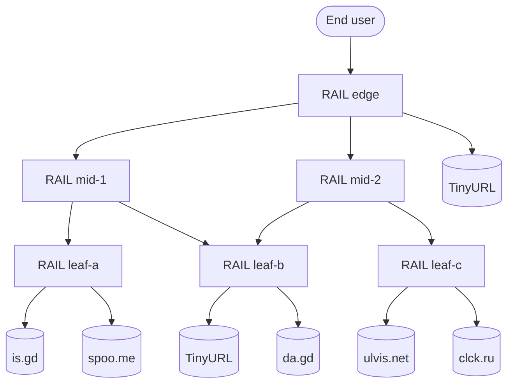

<p align="center">
  
</p>

<p align="center">
  <a href="https://github.com/HelgeSverre/rail-rs/actions/workflows/ci.yml"></a>
  <a href="https://github.com/HelgeSverre/rail-rs/releases/latest"></a>
  <a href="LICENSE"></a>
  <a href="https://github.com/HelgeSverre/rail-rs/pkgs/container/rail-rs"></a>
  <a href="charts/rail"></a>
  
  <br>
  
  
  
  
  
  
</p>

# RAIL: Redundant Array of Inexpensive Links

**RAIL is an enterprise-grade link resilience platform.** It protects your organization's
shortened URLs against provider failure by shortening every URL with multiple independent
third-party URL shortening vendors at once, then distributing inbound traffic across them with
continuous health verification.

RAIL is itself a URL shortener. A RAIL deployment can therefore serve as an upstream vendor for
another RAIL deployment. We call this **Recursive Redundancy™**.

> [!NOTE]
> RAIL is production-ready, in the sense that it runs in production.

---

## Table of contents

- [Executive summary](#executive-summary)
- [The problem](#the-problem)
- [The solution](#the-solution)
- [Architecture](#architecture)
- [Installation](#installation)
- [Getting started](#getting-started)
- [Configuration](#configuration)
- [API reference](#api-reference)
- [Operational considerations](#operational-considerations)
- [Frequently asked questions](#frequently-asked-questions)
- [Development](#development)
- [Acknowledgements](#acknowledgements)

## Executive summary

| | |
| --- | --- |
| **Category** | Link Resilience Platform (LRP) |
| **Supported vendors** | 13, including RAIL itself |
| **Balancing strategies** | 3 |
| **Maximum supported nesting depth** | 18 tiers (browser-imposed) |
| **Deployment targets** | Bare metal, Docker, Docker Compose, Kubernetes |
| **Infrastructure as Code** | Terraform provider |
| **Persistence** | SQLite, one per tier, for isolation |
| **Vendor lock-in** | None. Lock-in to five vendors at once, simultaneously |

## The problem

URL shorteners fail. Google shut down `goo.gl` redirects in August 2025. Countless smaller providers
have expired, been acquired, or begun displaying interstitial pages. Each shortened link an
organization distributes is a single point of failure, often printed on physical media with no
remediation path.

Industry-standard guidance recommends placing a short-link buffer between printed material and its
destination. RAIL extends this best practice by placing a buffer between the buffer and its
destinations.

## The solution

RAIL implements a three-stage link assurance lifecycle:

1. **Fan-out provisioning.** On `POST /api/shorten`, RAIL submits the destination URL to every
   configured upstream vendor concurrently. Each vendor-issued short link is retained as a
   *mirror*.
2. **Balanced resolution.** On `GET /{id}`, RAIL selects a healthy mirror according to the
   configured strategy and responds with `302 Found`. RAIL never issues `301 Moved Permanently`:
   a permanent redirect is cached by the client and would allow end users to bypass the load
   balancer, which is unacceptable.
3. **Continuous verification.** A background sweep resolves every mirror hop by hop. A mirror
   remains in rotation only while its redirect chain demonstrably reaches the original destination.
   Mirrors that expire, are hijacked, or begin serving interstitial pages are evicted
   automatically.

If every mirror is unavailable, RAIL enters **Degraded Mode** and redirects to the destination
directly. Degraded Mode delivers full functionality without any of the redundancy and is not
recommended.

## Architecture

The reference architecture, *The Pyramid*, deploys six RAIL tiers:



Example resolution path, as observed in production:

```
$ rail trace http://edge.rail.localhost:8080/Y4BCXFY
  0  302      3ms  http://edge.rail.localhost:8080/Y4BCXFY  [rail:edge]
  1  302     26ms  http://mid-1.rail.localhost:8091/rtYbWr9  [rail:mid-1]
  2  302     23ms  http://leaf-b.rail.localhost:8082/3uqF31a  [rail:leaf-b]
  3  301     97ms  https://tinyurl.com/2982vg5k
  4  200    113ms  https://github.com/helgesverre

4 redirects, headroom 16 before ERR_TOO_MANY_REDIRECTS
```

## Installation

### Prebuilt binaries

Binaries are published for Linux (x86_64, aarch64) and macOS (Intel, Apple Silicon).

```sh
# Apple Silicon. Substitute your target triple as appropriate.
curl -fsSL https://github.com/HelgeSverre/rail-rs/releases/latest/download/rail-aarch64-apple-darwin.tar.gz | tar xz
sudo mv rail-aarch64-apple-darwin/rail /usr/local/bin/
rail --version
```

| Platform | Target |
| --- | --- |
| Linux x86_64 | `x86_64-unknown-linux-gnu` |
| Linux ARM64 | `aarch64-unknown-linux-gnu` |
| macOS Intel | `x86_64-apple-darwin` |
| macOS Apple Silicon | `aarch64-apple-darwin` |

Each archive is accompanied by a `.sha256` checksum. Verify it. Your auditors will ask.

### From source

```sh
cargo install --git https://github.com/HelgeSverre/rail-rs --locked
```

### Container image

```sh
docker run --rm -p 8080:8080 -v rail-data:/data ghcr.io/helgesverre/rail-rs:latest
```

Multi-architecture images (`linux/amd64`, `linux/arm64`) are published to GitHub Container Registry
for every release. The container runs as uid 10001. Use a named volume as shown; a bind-mounted host
directory must be writable by that uid (`chown 10001 ./data`).

### Docker Compose (reference architecture)

```sh
git clone https://github.com/HelgeSverre/rail-rs && cd rail-rs
docker compose up -d --build --wait
curl -s http://edge.rail.localhost:8080/api/tree
```

Then open `http://edge.rail.localhost:8080` in Chrome or Firefox.

Every tier is addressable as `<name>.rail.localhost:<port>`. Inside the Compose network the name
resolves through a Docker DNS alias. On the host, `*.localhost` resolves to loopback per RFC 6761.
A short URL is therefore valid both inside the cluster and in the operator's browser. Chrome,
Firefox and curl implement this; Safari and the macOS system resolver do not, which is why RAIL
ships its own resolver fallback for operating systems that have not read RFC 6761.

### Kubernetes (Helm)

```sh
helm install rail oci://ghcr.io/helgesverre/charts/rail --version 0.3.0 \
  -n rail --create-namespace --wait
helm test rail -n rail
```

The chart deploys The Pyramid by default. The topology is defined in `values.yaml` under
`instances`. An upstream of `rail:<name>` references another instance in the same release, and
references to unknown instances fail at render time.

```yaml
instances:
  - name: leaf
    upstreams: [is.gd, tinyurl, da.gd, spoo.me]
  - name: edge
    upstreams: [rail:leaf, ulvis]
```

Without ingress, short links point at `*.svc.cluster.local` and only resolve inside the cluster
(and from macOS on OrbStack). To issue links to the public, enable ingress. Every tier is then
routed at `<instance>.<host>`, because a visitor's redirect chain passes through all of them:

```yaml
ingress:
  enabled: true
  className: nginx
  host: rail.example.com          # edge.rail.example.com, mid-1.rail.example.com, ...
  annotations:
    cert-manager.io/cluster-issuer: letsencrypt
  tls:
    enabled: true
    secretName: rail-tls          # must cover *.rail.example.com
```

The hosts must also resolve from inside the cluster, since every tier verifies its mirrors through
their public URLs.

Credentials for [licensed vendors](#licensed-vendors) are loaded from an existing Secret, for the
whole release or per instance:

```sh
kubectl -n rail create secret generic rail-vendors \
  --from-literal=RAIL_XGD_KEY=... --from-literal=RAIL_CUTTLY_KEY=...
```

```yaml
credentialsSecret: rail-vendors
instances:
  - name: leaf
    upstreams: [x.gd, cutt.ly, is.gd]
```

`replicas` is fixed at 1 because every tier keeps its own database. RAIL scales horizontally
through vertical nesting.

### Terraform

Links can be managed as code with the
[Terraform provider for RAIL](https://github.com/HelgeSverre/terraform-provider-rail):

```hcl
resource "rail_link" "quarterly_report" {
  url = "https://example.com/q3/synergy-report.pdf"
}
```

In accordance with RAIL's data retention policy, `terraform destroy` removes the link from state
and leaves it provisioned.

## Getting started

```sh
rail serve --upstream is.gd,tinyurl,da.gd,spoo.me,ulvis
```

```sh
curl -s -X POST localhost:8080/api/shorten \
  -H 'content-type: application/json' \
  -d '{"url":"https://example.com/quarterly-synergy-report"}'
```

```json
{
  "short_url": "http://localhost:8080/dGJqXvP",
  "compression_ratio": 0.66,
  "degraded": false,
  "reused": false,
  "failed": [],
  "id": "dGJqXvP",
  "target": "https://example.com/quarterly-synergy-report",
  "created_at": 1793721600,
  "mirrors": [
    {
      "upstream": "da.gd",
      "short_url": "https://da.gd/tnKciF",
      "healthy": true,
      "latency_ms": null,
      "last_checked": null,
      "last_error": null
    }
  ]
}
```

The response lists one entry under `mirrors` per vendor; one is shown. `latency_ms`, `last_checked`
and `last_error` are populated by the first verification sweep.

`compression_ratio` is the short URL's length divided by the destination's. Values above `1.0`
indicate that RAIL has made the URL longer. This is expected in multi-tier deployments and does not
indicate a fault.

To audit a link's resolution path:

```sh
rail trace http://localhost:8080/dGJqXvP
```

## Configuration

Every option can be set by flag or environment variable.

| Flag | Environment | Default | Description |
| --- | --- | --- | --- |
| `--name` | `RAIL_NAME` | `rail` | Tier name, reported in `X-Rail-Instance` |
| `--listen` | `RAIL_LISTEN` | `0.0.0.0:8080` | Bind address |
| `--public-url` | `RAIL_PUBLIC_URL` | `http://localhost:8080` | Base URL short links are issued under |
| `--upstream` | `RAIL_UPSTREAMS` | `is.gd,tinyurl,da.gd,spoo.me` | Comma-separated vendors (see below). Duplicates are rejected |
| `--strategy` | `RAIL_STRATEGY` | `round-robin` | `round-robin`, `random`, `fastest` |
| `--db` | `RAIL_DB` | `rail.db` | SQLite database path |
| `--health-interval` | `RAIL_HEALTH_INTERVAL` | `300` | Seconds between verification sweeps |
| `--allow-private-targets` | `RAIL_ALLOW_PRIVATE_TARGETS` | off | Accept destinations on loopback, private and link-local addresses |
| `--tinyurl-token` | `RAIL_TINYURL_TOKEN` | | Token for the `tinyurl-api` vendor |
| `--yourls-signature` | `RAIL_YOURLS_SIGNATURE` | | Signature token for `yourls+` vendors |
| | `RAIL_*_KEY`, `RAIL_*_TOKEN` | | Credentials for licensed vendors; see [Licensed vendors](#licensed-vendors) |

### Supported vendors

| Vendor | Identifier | Credentials | Notes |
| --- | --- | --- | --- |
| is.gd | `is.gd` | | |
| TinyURL | `tinyurl` | | Legacy keyless API |
| TinyURL | `tinyurl-api` | `RAIL_TINYURL_TOKEN` | Official API, with a quota |
| da.gd | `da.gd` | | |
| spoo.me | `spoo.me` | | Anonymous limit of 20 links per minute |
| ulvis.net | `ulvis` | | Slowest first hop observed (about 1.3 s) |
| rlu.ru | `rlu.ru` | | Issues `http://` links |
| clck.ru | `clck.ru` | | Adds a Yandex safe-browsing hop before the destination |
| v.gd | `v.gd` | | Shows browsers an interstitial; see [Vendor interstitial policy](#vendor-interstitial-policy) |
| httpbin.dev | `httpbin.dev` | | HTTP testing service; link is built locally (`/redirect-to?url=`) |
| Postman Echo | `postman-echo` | | HTTP testing service; link is built locally (`/redirect-to?url=`) |
| YOURLS (self-hosted) | `yourls+<base-url>` | `RAIL_YOURLS_SIGNATURE` | Your own instance |
| Kutt (self-hosted) | `kutt+<base-url>` | `RAIL_KUTT_KEY` | Your own instance. Asks for an existing link instead of minting a duplicate |
| Shlink (self-hosted) | `shlink+<base-url>` | `RAIL_SHLINK_KEY` | Your own instance. Asks for an existing link instead of minting a duplicate |
| RAIL | `rail+<base-url>`, e.g. `rail+http://leaf-a.rail.localhost:8081` | | |
| None (Degraded Leaf) | `none` | | |

Credentials are read from the environment and never appear in vendor identifiers, so
`/api/topology`, `/api/tree` and the logs list vendors without exposing secrets. A tier that
lists a vendor without its credentials refuses to start, naming the missing variable.

### Licensed vendors

For organizations whose procurement policy requires a commercial relationship with every link in
the chain, RAIL supports the following account-based vendors. Each one expects its credentials in
the environment.

| Vendor | Identifier | Credentials | Free tier | Verification |
| --- | --- | --- | --- | --- |
| x.gd | `x.gd` | `RAIL_XGD_KEY` | Yes; key issued by e-mail | Live |
| Cuttly | `cutt.ly` | `RAIL_CUTTLY_KEY` | 30 links a month, 3 API calls a minute | Live |
| Short.io | `short.io` | `RAIL_SHORTIO_KEY`, `RAIL_SHORTIO_DOMAIN` | 1,000 links in total; redirects need a verified phone number | Live |
| Dub | `dub` | `RAIL_DUB_TOKEN` | 25 links a month; work e-mail required | Contract tests |
| Rebrandly | `rebrandly` | `RAIL_REBRANDLY_KEY` | 10 links a month | Contract tests |
| Linkly | `linkly` | `RAIL_LINKLY_KEY`, `RAIL_LINKLY_WORKSPACE` | 100 links a month | Contract tests |
| Bitly | `bitly` | `RAIL_BITLY_TOKEN` | Links display an advertisement first; paid plans redirect directly | Contract tests |
| T.ly | `t.ly` | `RAIL_TLY_TOKEN` | None; the API requires a paid plan | Contract tests |

*Live* means a production account minted links through RAIL and those links redirected to their
destination. Kutt and Shlink are verified the same way against self-hosted instances. *Contract
tests* means RAIL is tested against a replica of the vendor's documented API, and the vendor has
not yet been onboarded. Short.io withholds redirects with a 403 until the account owner verifies a
phone number. `RAIL_SHORTIO_DOMAIN` is the domain Short.io assigned to the account.

Licensed vendors bill per link, and RAIL creates one link per destination per vendor, so a
destination costs as many links as there are licensed vendors in the tier. Link creation is the
only licensed call: verification sweeps follow the published short link and never call a vendor's
API.

The following were evaluated and rejected. kutt.to has suspended sign-ups (self-hosted Kutt is
supported). tiny.cc accepts new API users by application form only. Replug and Switchy restrict
their APIs to agency plans or support requests. Sniply frames the destination instead of
redirecting to it, and Firebase Dynamic Links was shut down. httpbin.org and httpbingo.org
restrict `redirect-to` to example domains. Google, Facebook and LinkedIn redirectors present
warning pages. goo.gl no longer issues links.

### Balancing strategies

| Strategy | Behavior |
| --- | --- |
| `round-robin` | Rotates through healthy mirrors in order. Equitable to all vendors, including slow ones |
| `random` | Selects a healthy mirror uniformly at random |
| `fastest` | Selects the healthy mirror with the lowest first-hop latency from the last sweep |

## API reference

| Method | Route | Description |
| --- | --- | --- |
| `GET` | `/` | Self-service provisioning portal |
| `POST` | `/api/shorten` | Provision a link. Body: `{"url": "…"}`. Repeat requests for a destination return the existing link |
| `GET` | `/{id}` | Resolve a link. Responds `302` with `X-Rail-Instance` and `X-Rail-Upstream` headers |
| `GET` | `/{id}/info` | Mirror inventory with health, latency and last error |
| `GET` | `/{id}/trace` | Full resolution path from this tier, with remaining redirect budget |
| `GET` | `/{id}/qr` | SVG QR code for print collateral |
| `GET` | `/api/links` | All links held by this tier |
| `GET` | `/api/topology` | This tier and its direct upstreams |
| `GET` | `/api/tree` | The complete balancer hierarchy, resolved recursively, with cycles annotated |
| `GET` | `/healthz` | Liveness |

## Operational considerations

### Redirect budget

Chromium and Firefox abort after 20 consecutive redirects (`ERR_TOO_MANY_REDIRECTS`). Each RAIL tier
consumes one redirect, and the terminal vendor consumes at least one more. The supported maximum is
therefore 18 nested tiers. `/{id}/trace` reports the remaining `headroom` for capacity planning.

RAIL enforces the budget at provisioning time. Each nested `/api/shorten` call carries an
`X-Rail-Chain` header listing the tiers it has passed through, and a tier refuses (`508 Loop
Detected`) once the chain reaches 20. The tier above it then serves its link in Degraded Mode, so the
resulting link stays within the budget. The test suite provisions a 21-tier deployment and confirms
that the issued link resolves in exactly 20 redirects.

### Cycle mitigation

If tier A lists tier B as an upstream and B lists A, resolution would loop until the client aborts.
Before provisioning through a RAIL upstream, a tier walks the upstream graph through
`/api/topology` and excludes any upstream from which it can reach itself. The exclusion is reported
in the `failed` array with the full cycle path.

Tiers are identified by a random per-process id published in `/api/topology`, not by URL. A tier
reached as `localhost` in one configuration and as `127.0.0.1` in another is still recognized. Should
detection miss a cycle regardless, the `X-Rail-Chain` header ends it: a tier that finds its own id in
the chain refuses the request with `508 Loop Detected`.

### Destination policy

Every destination is fetched by `/{id}/trace` and resolved by every verification sweep. RAIL
therefore refuses destinations on loopback, private, link-local and other non-public addresses,
including `*.localhost` names and hostnames that resolve to such addresses, to avoid becoming a
server-side request forgery probe. Intranet deployments can opt out with `--allow-private-targets`.
Verification sweeps stop at the destination without requesting it.

### Vendor interstitial policy

Some vendors (notably v.gd) return a redirect to command-line clients but present an interstitial
confirmation page to browsers. RAIL verifies mirrors using a browser-class User-Agent, so these
mirrors are correctly classified as unhealthy for human traffic and evicted.

### Vendor relations

Every tier verifies its own mirrors independently, so the verification load on each vendor grows
with the number of nested tiers. The default sweep interval of 300 seconds is calibrated to keep
RAIL on good terms with the public URL shortening ecosystem. A sweep verifies at most 8 mirrors
concurrently, and each verification is limited to 60 seconds.

### Service level objectives

RAIL's availability target is the availability of the most available vendor, minus RAIL. See
[Frequently asked questions](#frequently-asked-questions).

## Frequently asked questions

**Isn't RAIL itself a single point of failure?**
Yes. Deploy several RAIL tiers and front them with another RAIL tier.

**Isn't that tier a single point of failure?**
See previous answer.

**Why are short URLs sometimes longer than the original?**
Resilience has a cost. The cost is characters.

**Can I scale a tier to more than one replica?**
Each tier holds its own database. To add capacity, add a tier.

**Why Rust?**
RAIL handles mission-critical redirect traffic, where memory safety and blazing speed are
non-negotiable. A typical tier resolves a link in under a millisecond before handing the visitor to a
vendor that takes 200.

**Is RAIL affiliated with any of the listed vendors?**
No. RAIL uses their public APIs as documented. Please be kind to them.

## Development

```sh
cargo fmt --check
cargo clippy --all-targets -- -D warnings
cargo test
```

The integration suites in `tests/` run real tiers and misbehaving vendors on loopback, so they never
contact third-party vendors. CI additionally verifies:

| Job | Scope |
| --- | --- |
| Rust | fmt, clippy and tests on Linux and macOS |
| Helm chart | `helm lint --strict`, kubeconform schema validation with and without ingress, topology validation |
| Pyramid (docker compose) | six-tier offline deployment, traced end to end |
| Pyramid (kind) | six-tier offline Kubernetes deployment, verified with `helm test` |

Releases are cut by pushing a `v*` tag, which publishes binaries, a multi-architecture container
image and the Helm chart.

## Acknowledgements

Inspired in part by [a post on why printed QR codes should point at a short-link buffer instead of
the final URL](https://dev-null.sh/@msamgan/commits/01a1a1a7-cf53-71ed-83c6-9974d7d09522). RAIL
takes that advice seriously.

## License

[MIT](LICENSE). Mission-critical deployments are supported on a best-effort basis by nobody.
